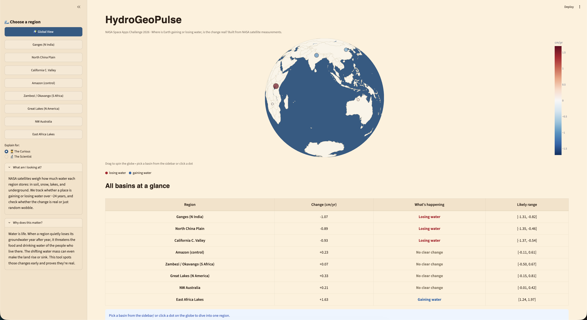
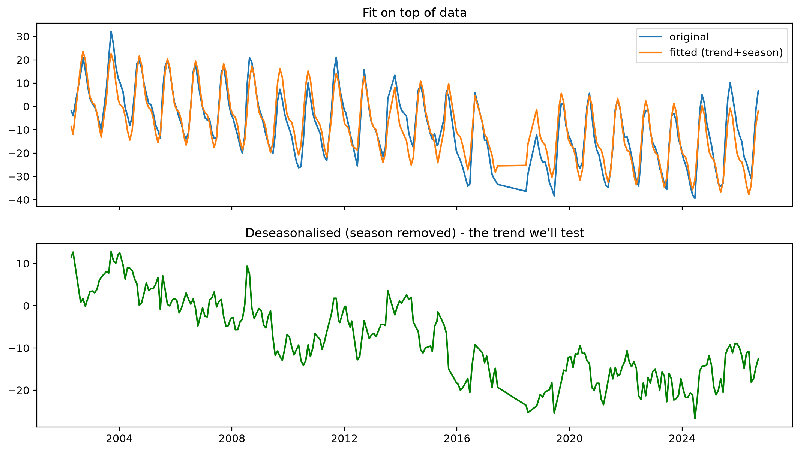
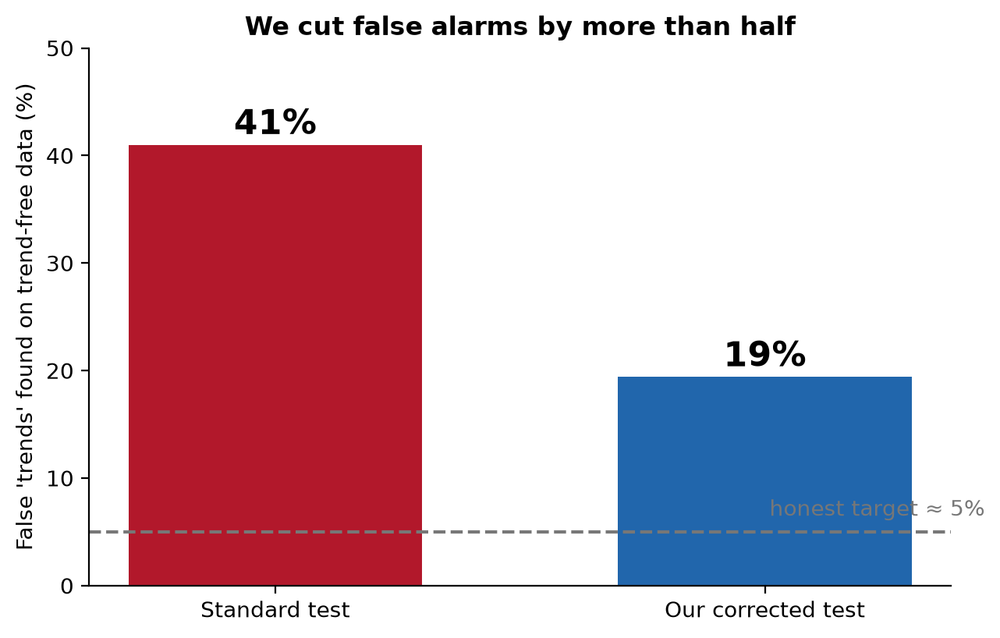

# HydroGeoPulse

**Is Earth's water really changing — and can you trust the answer?**



A tool that detects terrestrial water-storage trends from NASA GRACE/GRACE-FO satellite data, and most importantly — **proves those trends are statistically real, not noise.**

- **Challenge:** Be an Earth System Trend Detective — NASA Space Apps Challenge 2026
- **Team:** Mathematica (Owen Hee), Perth
- **Live app:** `streamlit run app.py` (see [Run it](#run-it))

---

## The problem

Hundreds of millions of people depend on groundwater that is quietly vanishing. But "it looks like it's dropping" is not necessarily proof, seasonal cycles and autocorrelated noise routinely fake trends, and most trend tools over-claim statistical significance as a result. HydroGeoPulse is built to do honest trend detection: it measures how fast water storage is changing, tests whether that change is real, and validates its own statistical methods against data where the right answer is known.

---

## What it does

Pick a region and HydroGeoPulse answers four questions NASA's challenge poses — *what* is changing, *where*, *how much*, and *is it significant* — with:

- **Trend magnitude** — robust rate of change in cm/year (equivalent water height)
- **Significance** — tested with autocorrelation-corrected statistics
- **Uncertainty** — honest 95% confidence intervals
- **Anomalies** — unusually wet/dry months, flagged by three benchmarked detectors
- **Two audiences** — a plain-English "Curious" mode and a technical "Scientist" mode, toggled live
- **An interactive 3-D globe** — spin it, click a basin, see its full analysis

---

## Method (the honest-stats pipeline)



1. **Acquire** — JPL GRACE/GRACE-FO Mascon water-storage grid (one global NetCDF, 2002–present).
2. **Regionalize** — cos(latitude)-weighted area-average over each basin's bounding box → one monthly series.
3. **Deseasonalize** — harmonic regression (annual + semiannual sin/cos) models and removes the seasonal cycle.
4. **Trend magnitude** — Theil–Sen slope (robust to outliers), in cm/year.
5. **Significance** — Mann–Kendall test, **corrected for autocorrelation (Hamed–Rao)** — because sticky (autocorrelated) data fools the standard test.
6. **Uncertainty** — moving-block bootstrap 95% confidence interval that preserves autocorrelation (resamples residuals in blocks, keeps the fitted trend fixed).
7. **Multiple testing** — Benjamini–Hochberg FDR control across all basins.

## Validation (the differentiator)



Most projects stop at running the stats. This one **proves the stats can be trusted:**

- **False-alarm calibration (Monte Carlo).** On 500 synthetic series with *no trend* but realistic autocorrelation, the **standard** Mann–Kendall test falsely reports a significant trend **41%** of the time; the **autocorrelation-corrected** test cuts that to **~19%** (honest ideal = 5%). We don't claim the correction is perfect, rather, we measure exactly how much it helps.
- **Anomaly-detector benchmark (synthetic injection).** We plant known anomalies in clean data and score three detectors on ground truth: **2σ threshold** (high recall), **MAD** (high precision, robust to masking), and **Isolation Forest** (ML). Finding: for clear anomalies the simple robust methods beat the ML, so we ship the simple method and explain why. Knowing *when not to use ML* is a feature in it of itself.

---

## Key findings (8 basins, 2002–2026)

| Region | Rate (cm/yr) | Verdict | 95% CI |
|---|---|---|---|
| Ganges (N India) | −1.07 | **Losing water** | [−1.31, −0.82] |
| North China Plain | −0.89 | **Losing water** | [−1.35, −0.46] |
| California Central Valley | −0.93 | **Losing water** | [−1.37, −0.54] |
| East Africa Lakes | +1.63 | **Gaining water** | [1.24, 1.97] |
| Amazon (control) | +0.23 | No significant trend | [−0.11, 0.61] |
| Zambezi / Okavango | +0.07 | No significant trend | [−0.50, 0.67] |
| Great Lakes | +0.33 | No significant trend | [−0.15, 0.81] |
| NW Australia | +0.21 | No significant trend | [−0.01, 0.42] |

Three major agricultural regions losing groundwater, East Africa's lakes gaining after record rainfall, and four controls correctly returning no trend — all robust to the autocorrelation correction and FDR control. Same planet, opposite trends, and a tool that reports "no trend" when there is none.

---

## Why it matters for the solid Earth

Water is a mass load on the crust. When a region loses water, the crust rebounds upward (elastic unloading); gaining water pushes it down. So these trends are not only about water — they physically move the ground, measurable by GPS. HydroGeoPulse detects and validates the load; published geodesy measures the resulting deformation in the same regions:

- **Materna et al. (2021)**, *Geophysical Journal International* — GRACE-based loading explains seasonal vertical GNSS motion across South & SE Asia, including the Ganges–Brahmaputra.
- **Amos et al. (2014)**, *Nature* — Central Valley groundwater depletion drives measurable crustal uplift and modulates San Andreas fault stress.
- **Bettinelli et al. (2008)** — Himalayan seismicity is modulated by the annual hydrological load.

We detect the cause and validate it; the deformation and fault-stress links are the documented downstream effects.

---

## Run it

```bash
# 1. install
pip install streamlit plotly pandas numpy scipy statsmodels scikit-learn pymannkendall xarray netCDF4 matplotlib

# 2. get the data (see Data below) and place the .nc file in data/

# 3. generate the per-basin outputs
#    run notebooks/01_explore.ipynb top to bottom -> writes outputs/

# 4. launch the app
streamlit run app.py
```

## Project structure

```
hydrogeopulse/
├── data/                    # GRACE mascon .nc  (not committed — see Data)
├── notebooks/
│   └── 01_explore.ipynb     # full analysis: pipeline, validation, freeze-to-outputs
├── outputs/
│   ├── summary.csv          # per-basin trend, CI, significance, coordinates
│   └── basins/*.csv         # per-basin time series + anomaly flags (the app reads these)
├── .streamlit/config.toml   # theme
├── app.py                   # Streamlit app
└── README.md
```

The app only reads the small precomputed files in `outputs/` — it never touches the raw NetCDF or recomputes, so it loads instantly.

## Data

**JPL GRACE and GRACE-FO Mascon Ocean, Ice, and Hydrology Equivalent Water Height, Release 06.3 v04**
(`TELLUS_GRAC-GRFO_MASCON_GRID_RL06.3_V4`), NASA JPL / PO.DAAC — a single global NetCDF, 2002-04 to present, monthly, in cm equivalent water thickness. Requires a free [NASA Earthdata](https://urs.earthdata.nasa.gov/) login. The file is large and is **not** committed to this repo.

## Limitations

GRACE resolution is coarse (~300 km), so small basins suffer signal leakage. Trends are modelled as linear; the 2017–2018 inter-mission gap is treated as missing. Flagged anomalies are *statistical* — attributing a physical cause (drought, flood) requires independent data (e.g. GPM precipitation).

---

## Author

**Owen Hee** — Computer Science in Data Science, Monash University.
NASA Space Apps Challenge 2026, team *Mathematica*, Perth.

Built with NASA GRACE/GRACE-FO open data. Python · xarray · statsmodels · scikit-learn · pymannkendall · Streamlit · Plotly.